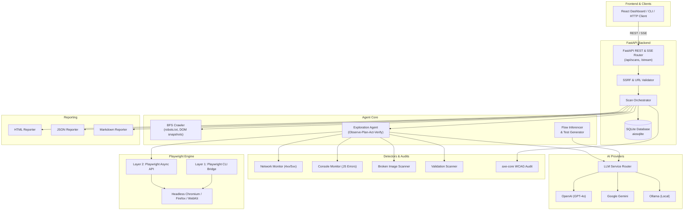

# 🐞 BugHunter — AI Autonomous Software Testing Agent

[](https://www.python.org/)
[](https://fastapi.tiangolo.com/)
[](https://playwright.dev/)
[](https://docs.pydantic.dev/)
[](LICENSE)
[-brightgreen.svg)]()

> **BugHunter** is an enterprise-grade autonomous QA agent that navigates, explores, detects defects, generates executable Playwright tests, and produces comprehensive visual bug reports — without requiring pre-written test scripts.

---

## 📑 Table of Contents

- [Overview](#-overview)
- [Key Features](#-key-features)
- [System Architecture](#-system-architecture)
- [Project Structure](#-project-structure)
- [Installation & Setup](#-installation--setup)
- [Configuration](#-configuration)
- [Quick Start Guide](#-quick-start-guide)
  - [1. Launching the Backend API](#1-launching-the-backend-api)
  - [2. Running the Broken Demo Target Site](#2-running-the-broken-demo-target-site)
  - [3. Triggering an Autonomous Scan](#3-triggering-an-autonomous-scan)
  - [4. Real-time SSE Progress Streaming](#4-real-time-sse-progress-streaming)
- [REST API Reference](#-rest-api-reference)
- [Detectors & Analysis Pipeline](#-detectors--analysis-pipeline)
- [Running Automated Tests](#-running-automated-tests)
- [Troubleshooting](#-troubleshooting)

---

## 🔭 Overview

BugHunter unifies the best capabilities of three testing platforms into a single cohesive system:
1. **Autonomous Exploration Engine** (`Observe-Plan-Act-Verify` loop) that explores web applications like a human tester.
2. **Deep Defect Detection Suite** monitoring network failures (4xx/5xx), uncaught browser console exceptions, broken images, and form validation bugs in real time.
3. **Automated WCAG Accessibility Auditor** powered by `axe-core`.
4. **AI Test Code Synthesis** that infers user flows and writes reproducible, executable `pytest` + `playwright` test files on the fly.
5. **Multi-LLM Integration** supporting **OpenAI** (`GPT-4o`, `GPT-4o-mini`), **Google Gemini** (`Gemini 2.0 Flash`), and local **Ollama** models (`llama3.2`).

---

## ⚡ Key Features

- 🧠 **Autonomous Exploration Loop**:
  - **Observe**: Extracts interactive buttons, links, inputs, forms, and DOM state.
  - **Plan**: AI agent determines the optimal next action (click, fill, navigate, submit).
  - **Act**: Executes Playwright browser interactions with automatic screenshot capture.
  - **Verify**: Continuously runs active defect detectors after every single action.
- 🔍 **Real-Time Defect Detectors**:
  - **Console Errors**: Captures JavaScript runtime errors, unhandled promise rejections, and fatal stack traces.
  - **Network Errors**: Tracks failed AJAX/Fetch/XHR requests, HTTP 4xx client errors, and HTTP 5xx server crashes.
  - **Broken Image Scanner**: Identifies unloaded images, missing `src` attributes, 404 image paths, and zero-dimension layout anomalies.
  - **Form Validation Checker**: Flags broken validations, native HTML5 constraint errors, and hidden/misconfigured alerts.
- ♿ **WCAG 2.1 AA Accessibility Auditing**:
  - Injects `axe-core` to calculate a weighted WCAG score (0–100) with rule IDs, node selectors, and remediation suggestions.
- 🧪 **AI Flow Inference & Test Code Generation**:
  - Automatically identifies user conversion funnels from browser history and generates executable, standalone `pytest-playwright` test scripts with retry validation.
- 👁️ **Visual Regression & Evidence Storage**:
  - Pixel diffing with Pillow and full-page screenshots associated with every bug finding.
- 📊 **Multi-Format Reporting**:
  - Interactive standalone HTML reports (with embedded CSS/JS).
  - Machine-readable JSON reports for CI/CD pipelines.
  - Clean GitHub-flavored Markdown reports.

---

## 🏗️ System Architecture



---

## 📁 Project Structure

```
bughunter/
├── backend/
│   ├── agent/
│   │   ├── crawler.py           # BFS crawler with robots.txt & DOM capture
│   │   ├── executor.py          # Subprocess pytest runner
│   │   ├── explorer.py         # Autonomous Observe-Plan-Act-Verify agent
│   │   ├── flow_inferencer.py   # User flow deduction from history
│   │   ├── orchestrator.py      # End-to-end scan pipeline & SSE broker
│   │   └── test_generator.py    # AI pytest-playwright test code generation
│   ├── analysis/
│   │   ├── accessibility.py     # axe-core WCAG 2.1 AA audit
│   │   ├── severity_scorer.py   # AI severity classifier (CRITICAL/HIGH/MED/LOW)
│   │   └── visual_diff.py       # Pillow visual difference engine
│   ├── db/
│   │   └── database.py          # Async SQLite database (aiosqlite)
│   ├── detectors/
│   │   ├── broken_images.py     # Image load & zero-dimension detector
│   │   ├── console_errors.py    # Browser console exception listener
│   │   ├── network_errors.py    # HTTP 4xx/5xx & network failure listener
│   │   └── validation_errors.py # DOM constraint & error message scanner
│   ├── reporting/
│   │   ├── html_reporter.py     # Jinja2 self-contained interactive report
│   │   ├── json_reporter.py     # Machine-readable CI report
│   │   └── markdown_reporter.py # Clean markdown summary generator
│   ├── services/
│   │   ├── llm.py               # Unified provider: OpenAI, Gemini, Ollama
│   │   └── url_validator.py     # SSRF defense & URL sanitizer
│   ├── cli_bridge.py            # Layer 1: Playwright CLI subprocess bridge
│   ├── config.py                # Pydantic Settings configuration
│   ├── main.py                  # FastAPI application entrypoint
│   └── models.py                # Pydantic v2 unified data models
├── demo/
│   └── app.py                   # Intentionally broken demo web application
├── tests/
│   └── unit/
│       ├── test_api.py          # FastAPI endpoint test suite
│       └── test_core.py         # Models, config & validator tests
├── .env.example                 # Environment configuration template
├── bughunter.db                 # SQLite database storage (auto-generated)
├── requirements.txt             # Python dependencies
└── README.md                    # Project documentation
```

---

## 🚀 Installation & Setup

### Prerequisites
- **Python 3.12+** or **Python 3.13**
- **pip** and **git**

### 1. Clone or Open the Workspace
```bash
cd "d:/Main Project/bughunter"
```

### 2. Create and Activate a Virtual Environment
```bash
# Windows (PowerShell)
python -m venv .venv
.venv\Scripts\Activate.ps1

# Linux / macOS
python3 -m venv .venv
source .venv/bin/activate
```

### 3. Install Dependencies
```bash
pip install -r requirements.txt
```

### 4. Install Playwright Browsers
```bash
playwright install chromium
```

---

## ⚙️ Configuration

Copy `.env.example` to `.env`:
```bash
cp .env.example .env
```

Configure your LLM provider and settings:

```ini
# ── LLM Provider (openai | gemini | ollama) ──
LLM_PROVIDER=openai

# OpenAI Configuration
OPENAI_API_KEY=sk-your-openai-api-key
OPENAI_MODEL=gpt-4o-mini

# Google Gemini Configuration
GEMINI_API_KEY=your-gemini-api-key
GEMINI_MODEL=gemini-2.0-flash-exp

# Ollama Configuration (Local)
OLLAMA_BASE_URL=http://localhost:11434
OLLAMA_MODEL=llama3.2

# ── Scanner Defaults ──
DEFAULT_MAX_DEPTH=3
DEFAULT_BROWSER=chromium
DEFAULT_HEADLESS=true
MAX_ACTIONS=50
SCAN_TIMEOUT_SECONDS=300

# ── Security & Demo Mode ──
# Set DEMO_MODE=true to allow scanning localhost / internal IPs
DEMO_MODE=true
ALLOWED_ORIGINS=["http://localhost:5173","http://localhost:3000"]

# ── Server ──
HOST=0.0.0.0
PORT=8000
LOG_LEVEL=INFO
```

---

## 🏁 Quick Start Guide

### 1. Launching the Backend API
Start the BugHunter FastAPI backend server from the `bughunter` root directory:
```bash
# If you are in bughunter/:
uvicorn backend.main:app --host 0.0.0.0 --port 8000 --reload

# If you are already inside bughunter/backend/:
uvicorn main:app --host 0.0.0.0 --port 8000 --reload
# (or simply: python main.py)
```
- 🖥️ **Web Dashboard**: **http://localhost:8000/** *(Full React UI served directly)*
- 📚 API Documentation (Swagger UI): **http://localhost:8000/docs**
- 🩺 Health Check: **http://localhost:8000/api/health**

---

### 2. Running the Broken Demo Target Site
BugHunter includes an intentionally broken web application with 10+ detectable bugs (broken images, runtime JS errors, 500 error APIs, missing a11y labels, broken navigation):

```bash
uvicorn demo.app:demo_app --host 0.0.0.0 --port 8080 --reload
```
- Demo Website: **http://localhost:8080**

---

### 3. Triggering an Autonomous Scan
Submit a scan request to BugHunter:

**Using PowerShell (Windows):**
```powershell
Invoke-RestMethod -Uri "http://localhost:8000/api/scans" -Method Post -ContentType "application/json" -Body '{"url": "http://localhost:8080", "max_depth": 2, "max_actions": 30, "headless": true, "enable_a11y": true, "enable_exploration": true}'
```

**Using cURL / Bash:**
```bash
curl -X POST "http://localhost:8000/api/scans" \
  -H "Content-Type: application/json" \
  -d '{
    "url": "http://localhost:8080",
    "max_depth": 2,
    "max_actions": 30,
    "headless": true,
    "enable_a11y": true,
    "enable_exploration": true
  }'
```

**Response:**
```json
{
  "scan_id": "scan_20261011_223015_a1b2c3",
  "status": "started",
  "url": "http://localhost:8080"
}
```

---

### 4. Real-time SSE Progress Streaming
Connect to the Server-Sent Events (SSE) stream to observe the agent's actions in real time:

```bash
curl -N "http://localhost:8000/api/scans/scan_20261011_223015_a1b2c3/stream"
```

Live event stream:
```
data: {"type": "status", "message": "Starting exploration: http://localhost:8080"}
data: {"type": "observe", "url": "http://localhost:8080", "step": 0}
data: {"type": "plan", "action": "click", "selector": "#add-to-cart", "step": 0}
data: {"type": "findings", "count": 2, "total": 2, "step": 0}
...
data: {"type": "completed", "total_findings": 7}
```

---

## 📡 REST API Reference

| Method | Endpoint | Description |
|---|---|---|
| `GET` | `/api/health` | Health check, version, and active provider info |
| `POST` | `/api/validate-url` | Validates target URL against SSRF and syntax rules |
| `POST` | `/api/scans` | Dispatches a new autonomous scan |
| `GET` | `/api/scans` | Lists recent scan histories with summary counts |
| `GET` | `/api/scans/{scan_id}` | Retrieves full scan metadata and status |
| `GET` | `/api/scans/{scan_id}/findings` | Returns all detected bug findings for a scan |
| `GET` | `/api/scans/{scan_id}/stream` | Server-Sent Events (SSE) stream for live scan updates |
| `GET` | `/api/scans/{scan_id}/report?format=html` | Downloads the generated interactive HTML report |
| `GET` | `/api/scans/{scan_id}/report?format=json` | Downloads the structured JSON report |
| `GET` | `/api/screenshots/{scan_id}/{file}` | Retrieves a captured bug evidence screenshot |

---

## 🔬 Detectors & Analysis Pipeline

| Detector | Method | What It Catches |
|---|---|---|
| **Console Errors** | Playwright `page.on("console")` | Uncaught `TypeError`, `ReferenceError`, unhandled rejections |
| **Network Errors** | Playwright `page.on("response")` + `requestfailed` | 404 Not Found, 500 Server Error, CORS rejections, aborted fetches |
| **Broken Images** | Injected DOM evaluator (`naturalWidth === 0`) | Missing image assets, invalid URLs, broken references |
| **Validation Errors** | DOM selector scanner & native HTML5 constraints | Form validation blocks, visible error alerts, invalid input fields |
| **Accessibility Audit** | Injected `axe-core 4.9.1` | Missing `alt` tags, poor color contrast, missing button labels |
| **Visual Diff** | Pillow image pixel comparison | Unexpected layout shifts and visual UI regressions |

---

## 🧪 Running Automated Tests

Run the test suite with `pytest`:

```bash
# Run all unit tests
pytest -v

# Run with output capture disabled
pytest -v -s

# Run specific test suite
pytest tests/unit/test_api.py -v
pytest tests/unit/test_core.py -v
```

**Test Coverage Highlights:**
- ✅ Pydantic v2 data models, enums, and timezone handling
- ✅ SSRF protection, URL scheme filtering, and demo-mode handling
- ✅ Settings loading and environment overrides
- ✅ FastAPI REST endpoints: `/api/health`, `/api/validate-url`

---

## 🛠️ Troubleshooting

- **FastAPI Startup Union Error**: Ensure FastAPI has `response_model=None` on routes returning `JSONResponse | FileResponse` unions.
- **SSRF Block on Localhost**: If you are testing local ports (e.g., `http://localhost:8080`), ensure `DEMO_MODE=true` is set in your `.env` or configuration.
- **Playwright Browser Not Found**: Run `playwright install chromium` inside your active virtual environment.
- **Missing API Keys**: When `LLM_PROVIDER=openai` or `gemini`, ensure `OPENAI_API_KEY` or `GEMINI_API_KEY` is set in `.env`. If no key is set, the agent automatically falls back to heuristic-based scanning.

---

## 📄 License

This project is licensed under the MIT License — see the [LICENSE](LICENSE) file for details.
